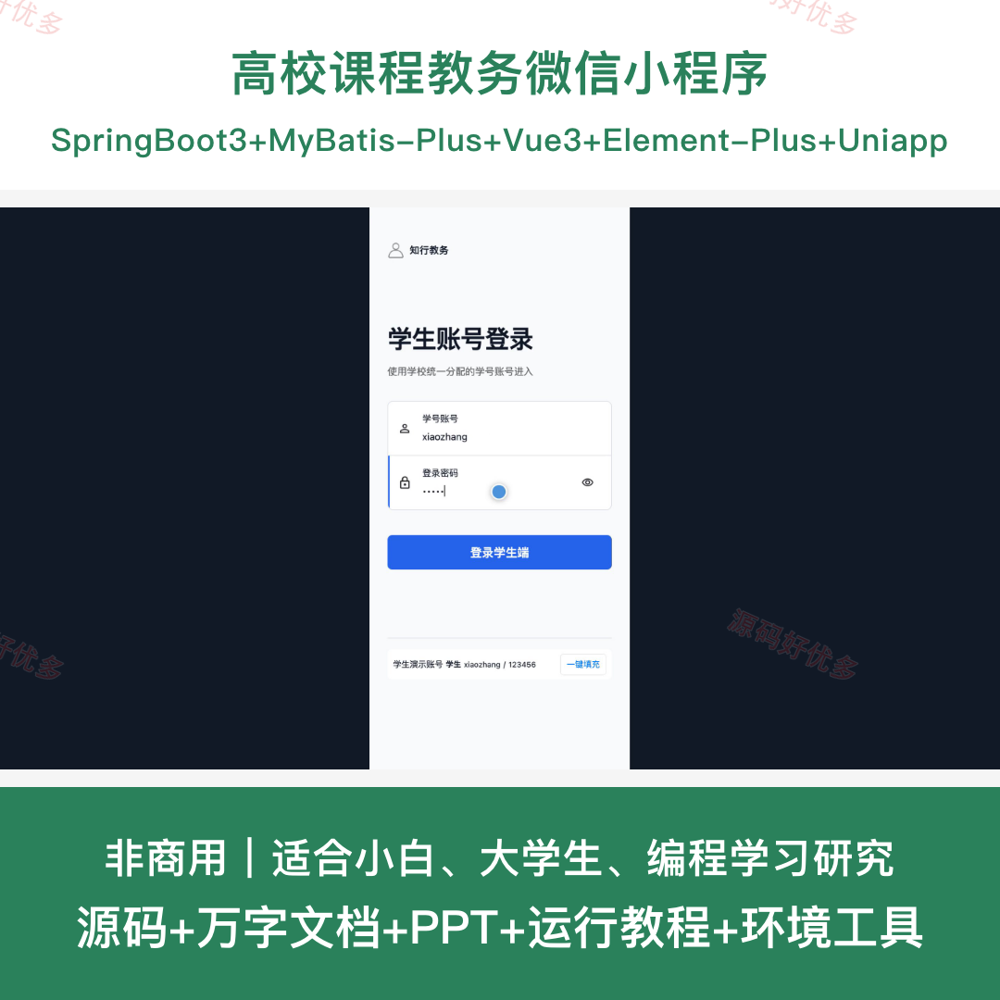
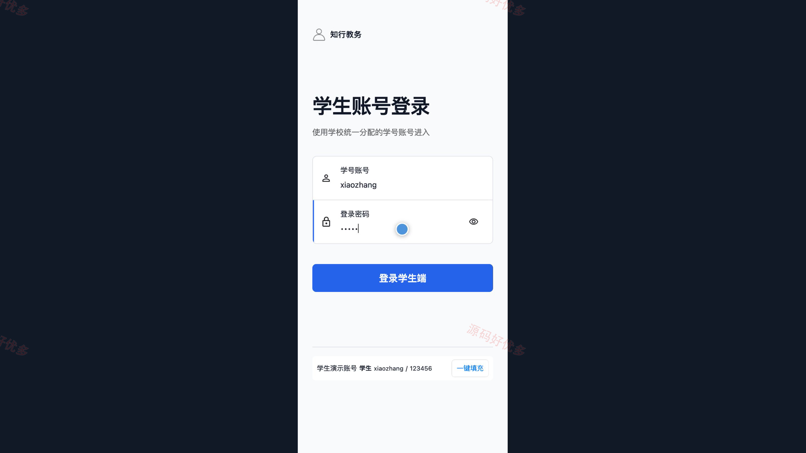
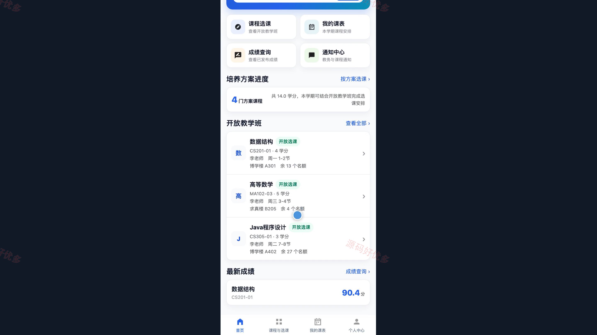
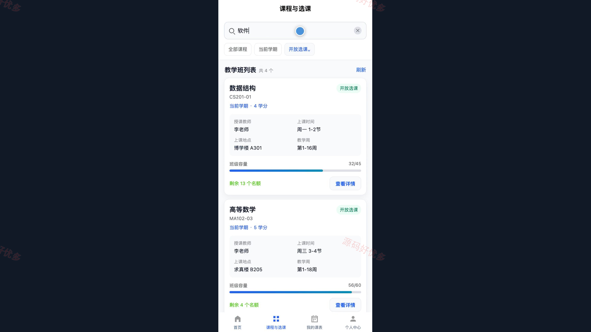
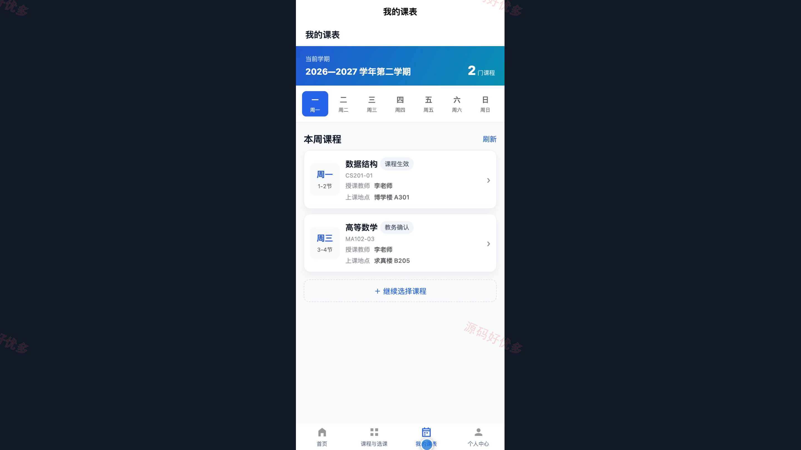
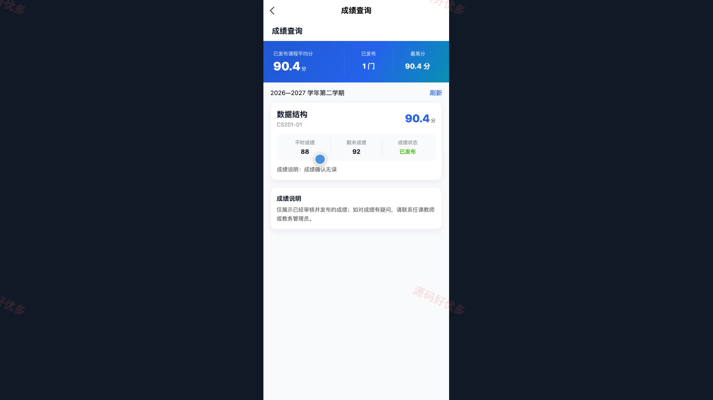
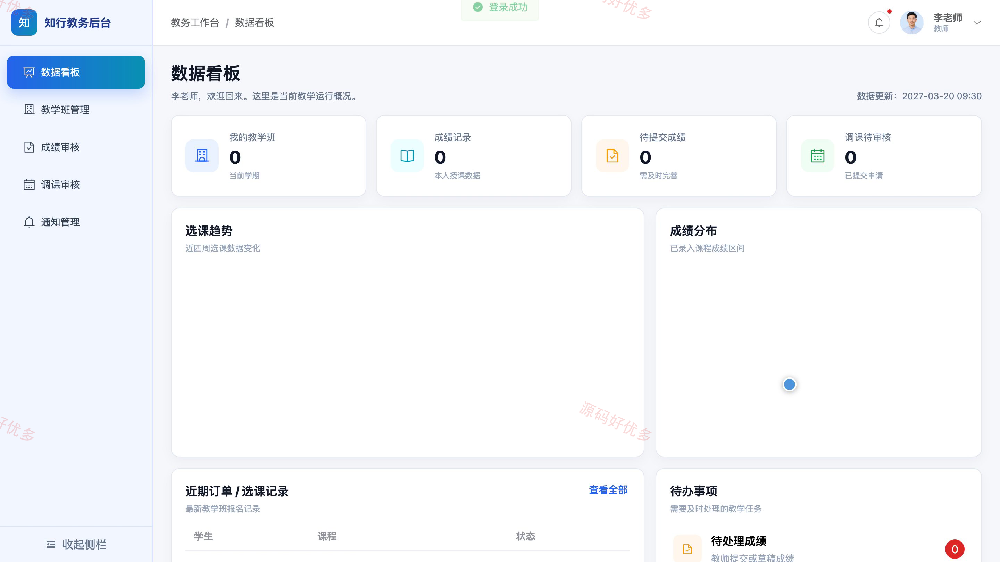
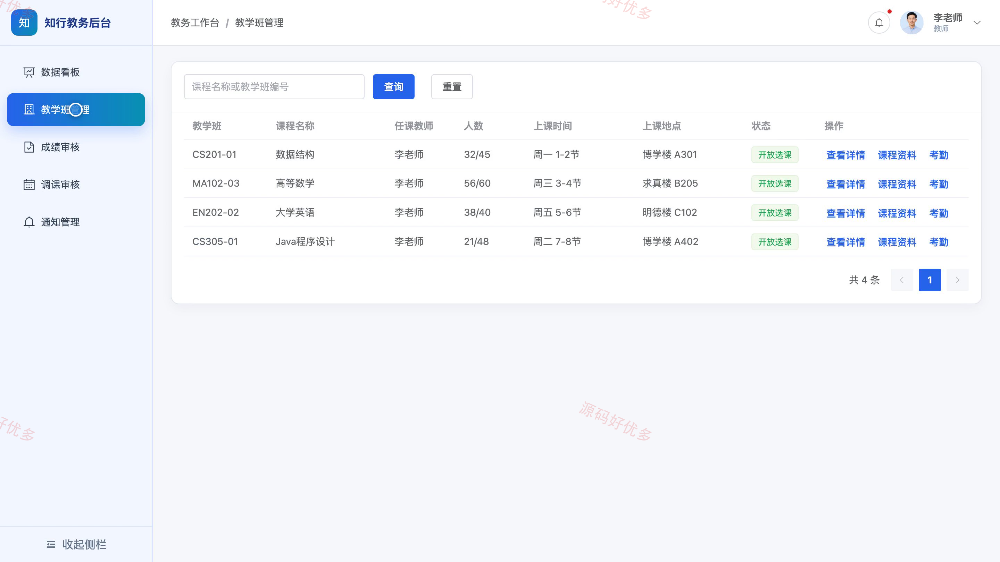
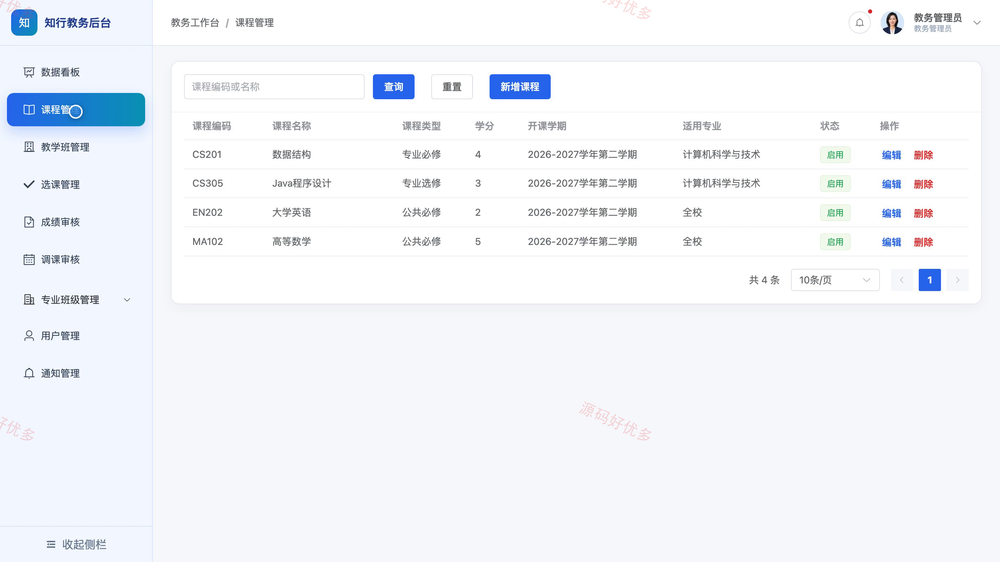

# bs044B
bs044B高校课程教务微信小程序源码 Java SpringBoot3 Vue3 文档 PPT
## 源码问题查看主页咨询

### 一、关键词
高校教务、课程选课、学生课表、成绩管理、教学管理

### 二、作品包含
源码+数据库+万字设计文档+PPT+全套环境和工具资源+本地部署教程

### 三、项目技术
前端技术： Html、Css、Js、Vue3.4、Element-Plus、uniapp
后端技术：Java、SpringBoot3.2.0、MyBatis-Plus

### 四、运行环境要求
开发工具：IDEA/eclipse + VSCODE + HBuilder X + 微信开发者工具

数据库：MySQL5.7+（共13张表）

数据库管理工具：Navicat10以上版本

环境配置软件： JDK17 + Maven3.6

前端Nodejs：16+

浏览器：谷歌浏览器

### 五、项目介绍
项目编号：bs044B

高校课程教务微信小程序连接学生、教师与教务管理员，支持培养方案查看、教学班选课、个人课表与成绩查询、考勤和成绩录入、调课审批以及课程和用户管理，覆盖日常教学与教务协作。

角色：学生、教师、教务管理员

学生功能：查看培养方案、浏览教学班与课程详情、在线选课、查看个人课表、查询成绩、查看教学通知、维护个人资料、修改密码。

教师功能：查看教学数据看板、管理教学班与查看学生、维护课程资料、登记学生考勤、录入与提交成绩、申请调课、发布教学通知、维护个人资料。

教务管理员功能：查看教务数据看板、管理课程、管理教学班、管理选课记录、审核成绩、审核调课申请、管理专业与班级、管理用户与通知。

### 六、运行截图

